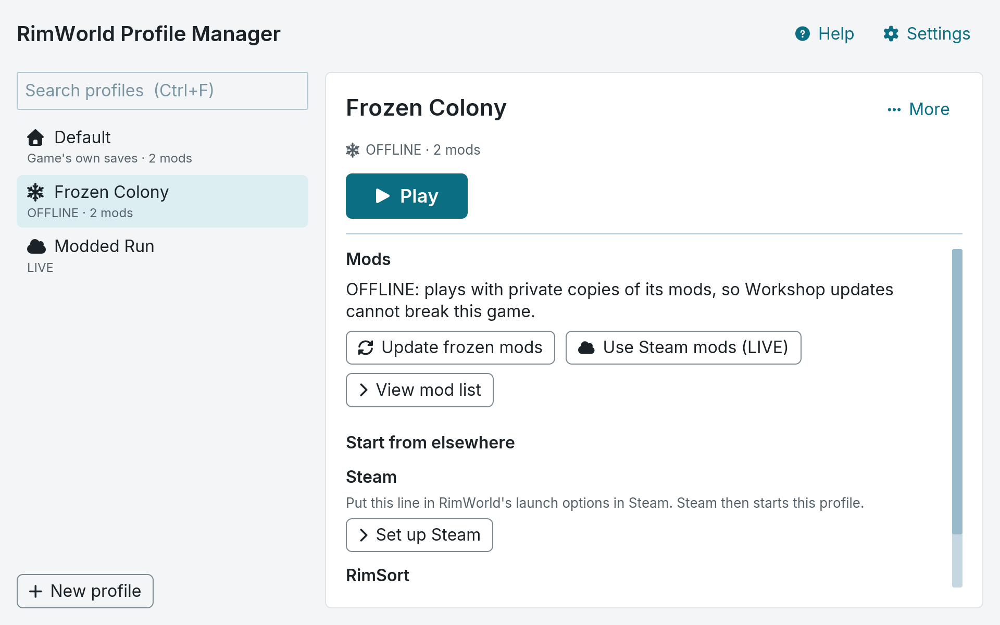

<p align="center">
  
</p>

<h1 align="center">RimWorld Profile Manager</h1>

<p align="center">
  Separate RimWorld profiles, each with its own saves, settings and mod list.
</p>

---

RimWorld Profile Manager keeps more than one RimWorld setup on one computer. Playing one profile never changes another.

- **LIVE profiles** use your Steam Workshop mods. Mod updates on Steam reach them.
- **OFFLINE profiles** keep private copies of their mods. A Workshop update cannot break a colony in progress. You choose when to update.
- **Default** is the game as it is without this app. Steam Cloud keeps syncing it.



You can start a profile from the app, from Steam's own Play button, or from [RimSort](https://github.com/RimSort/RimSort). The app runs on Windows and Linux.

## Download

Get the newest version from [Releases](https://github.com/keyz182/rimworld-profile-manager/releases/latest).

| System | File |
|---|---|
| Windows | `…-windows-x86_64-setup.exe` (installer) or `…-windows-x86_64.zip` |
| Linux | `…-x86_64.AppImage` or `…-linux-x86_64.tar.gz` |
| Debian, Ubuntu | `rwpm_…_amd64.deb`. Install it with `sudo apt install ./<file>`. |
| Fedora | `rwpm-….x86_64.rpm`. Install it with `sudo dnf install ./<file>`. |
| Arch Linux | `rwpm-bin` (the release) or `rwpm` (built from source), from the AUR. |

The deb and rpm packages are not signed. They put the app in `/opt/rwpm` and add a menu entry. Install and removal were tested on Debian 12, Ubuntu 24.04 and Fedora.

The [wiki](https://github.com/keyz182/rimworld-profile-manager/wiki) tells you how to install the app, set up Steam and RimSort, and fix problems. It has screenshots of each step.

## Game versions

A game version is a full copy of RimWorld that the app keeps. A profile can play one, so it stays on 1.6 while Steam moves to 1.7.

1. In Steam, switch RimWorld to the version to store. Wait for the update to finish.
2. In the app, choose "Game versions", then "Capture current game", then "Store it".
3. In Steam, switch back to the version that you normally play.
4. On a profile, choose "Change…" in the "Game version" section and pick the stored version.

Each game version takes about as much disk space as the game. A file system with copy-on-write, such as btrfs or APFS, shares the data until Steam changes the original. Windows game versions of 1.6 have no Steam overlay ([issue 5](https://github.com/keyz182/rimworld-profile-manager/issues/5)). See [Game versions](docs/game-versions.md) for the full steps, the disk numbers and the limits.

## Backups

An OFFLINE profile can go into one backup file. The file name ends in `.rimrim`. Use it to keep a safe copy, or to move a profile to another computer.

1. Select an OFFLINE profile. Choose "⋯", then "Back up…".
2. Tick what goes in: saves, log files and game files. The mods and settings are always in.
3. Choose "Back up", then choose where to save the file.

To use a backup, choose "Restore backup…" under the profile list and pick the `.rimrim` file. A restore always makes a new profile. It never changes a profile that you already have. On Windows (installer) and Linux you can also double-click a `.rimrim` file; see [Backups](docs/backups.md) for how to set it up.

A backup holds other people's mods. Check each mod's licence or ask its author before you share a backup. A backup with game files holds RimWorld's own files: do not share it. See [Backups](docs/backups.md) for the steps and the limits.

## Modpacks

A modpack is a small file that names the mods of a profile, in load order. The file name ends in `.rimpack`. It holds no mods and no game files. Use it to share a setup. A pack can have a cover picture and a description in Markdown, and a profile made from a pack can be reset to it.

1. Select a profile. Choose "⋯", then "Share as modpack…".
2. Tick what goes in: mod settings, your own scenarios and similar, game settings and saves. The mod list is always in.
3. Choose "Share", then choose where to save the file.

To use a modpack, choose "Open modpack…" under the profile list and pick the `.rimpack` file. The app makes a new profile and shows which mods you have, which to get from Steam and which to find yourself. The app can subscribe to the missing mods in Steam, or download them into an OFFLINE profile with Valve's steamcmd when Steam cannot be reached (on a Mac, steamcmd needs Rosetta 2). On Windows (installer) and Linux you can also double-click a `.rimpack` file.

Mod settings can hold private details, such as account logins. Only share settings you have checked. See [Modpacks](docs/modpacks.md) for the steps and the limits.

## Use from an AI agent

`rwpm mcp` runs an MCP server on standard input and output. An agent such as Claude Code can list profiles and their mods, check profile health, and make, copy and rename profiles. It cannot delete a profile, edit a mod list or start the game. See [MCP](docs/mcp.md) for the setup and the limits.

## Update check

The app can tell you when a new version is out. This is off until you turn it on. The app shows its own version next to the title.

1. Choose "Settings". Pick "Daily", "Weekly" or "Monthly" under "Check for updates". Choose "Save".
2. When a newer version is out, a line at the top says so. Choose "Release page" to open the download page in your browser. Choose "Dismiss" to hide the line until a newer version comes out.
3. To check at once, choose "Check now" in "Settings".

The check sends one request to GitHub. The request names this app and its version. GitHub also sees your internet address, as with any web request. The app sends nothing else about you or your computer. While the setting is "Off", the app sends nothing. The app does not download or install the update. You do that yourself.

## How it works

- Each profile has its own save folder. The app starts RimWorld with `-savedatafolder` set to that folder.
- An OFFLINE profile also loads a small payload through [UnityDoorstop](https://github.com/NeighTools/UnityDoorstop). The payload points the game's mods folder at the profile's frozen copies. The game files are not changed.
- On Windows, OFFLINE needs Doorstop's `winhttp.dll` in the RimWorld folder. The app asks before it adds the file, and you can remove it from the app.
- On RimWorld 1.7, an OFFLINE profile loads the payload as a .NET startup hook (`DOTNET_STARTUP_HOOKS`), not through Doorstop. Windows needs no `winhttp.dll` for 1.7.
- On 1.7, the game log of a profile is `<profile>/Logs/Player.log`.
- The first time a profile starts on 1.7, the game clears its mod list. A 1.6 mod list does not carry over. Keep separate profiles for 1.6 and 1.7. If you press Play in Steam without the launch options, Steam starts Default, and the game clears the mod list of Default.
- A profile with a stored game version starts that game version. `rwpm run` swaps the game in the launch line, and keeps any Steam wrappers before it. Steam's own Play button, without this app's launch options, starts the Steam version.
- The app does not change your load order. RimSort or the in-game mod menu does that.

## Build from source

You need:

- Rust (the version in `rust-toolchain.toml`; `rustup` installs it).
- On Linux: `pkg-config`, `libxkbcommon` and `libwayland` development files.
- For the OFFLINE payloads: the .NET 10 SDK. To run `scripts/test-hook.sh`, you also need the .NET 8 runtime.

```sh
cargo run -p rwpm              # start the app
scripts/check.sh               # format, lint and test
scripts/test-hook.sh           # test the 1.7 startup hook
scripts/package.sh linux       # Linux bundle (needs Docker)
scripts/package.sh windows     # Windows bundle (needs mingw-w64)
```

The release workflow also builds the AppImage (`scripts/appimage.sh`) and the Windows installer (`scripts/installer.sh`, needs NSIS).

| Folder | What is in it |
|---|---|
| `crates/rwpm-core` | All the logic: profiles, freezing, launching, Steam and RimSort. |
| `crates/rwpm` | The app (iced GUI), the `rwpm run` launcher and the `rwpm mcp` server. |
| `payload` | The C# payloads that OFFLINE profiles load: the Doorstop payload (1.6) and the startup hook (1.7). |
| `packaging`, `scripts` | Release bundles, installer and AppImage. |
| `e2e` | End-to-end tests against the real game on Windows. |

Commits follow [Conventional Commits](https://www.conventionalcommits.org/). A push to `main` makes a release when it has a `feat` or `fix` commit.


## FAQ

### Was this vibe coded?

Yes. I needed a thing that I didn't have time to write myself. AI took my plan and research and turned it into this codebase.

### Can you add X?

Maybe? Make an issue and we shall see.

### Why doesn't Y?

Make an issue to ask.

### I ran this program and my wife left me!

Well now you have time for Rimworld. 


## Licence

MIT. See [LICENSE](LICENSE).

The releases also include:

- UnityDoorstop 4.5.0, under LGPL-2.1, unchanged.
- The Inter font (SIL OFL 1.1) and Font Awesome Free icons (CC BY 4.0).

Each release has the full licence texts in its `licenses` folder.

RimWorld is a trademark of Ludeon Studios. This project is not made or endorsed by Ludeon Studios.
